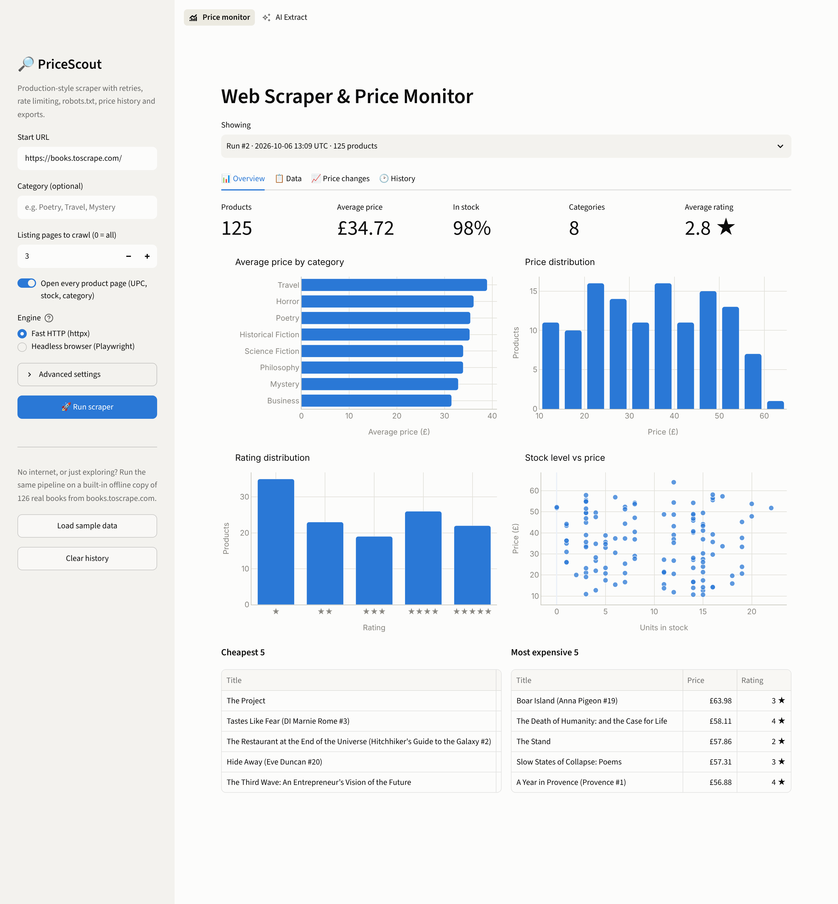
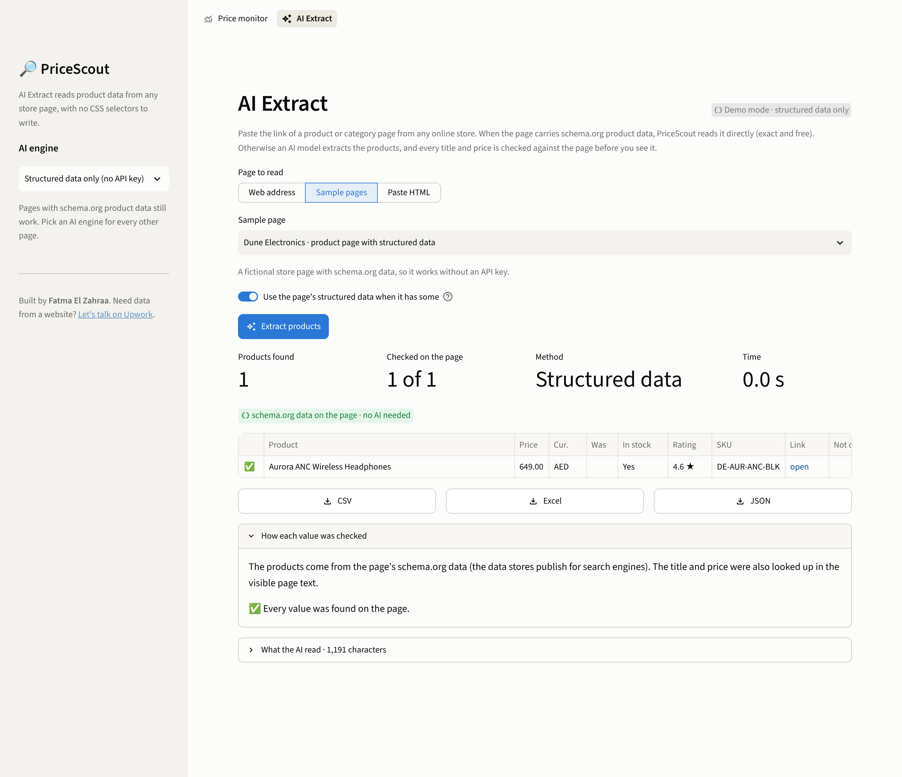
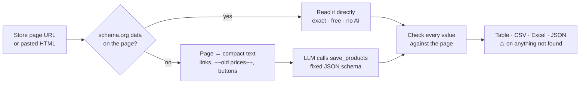
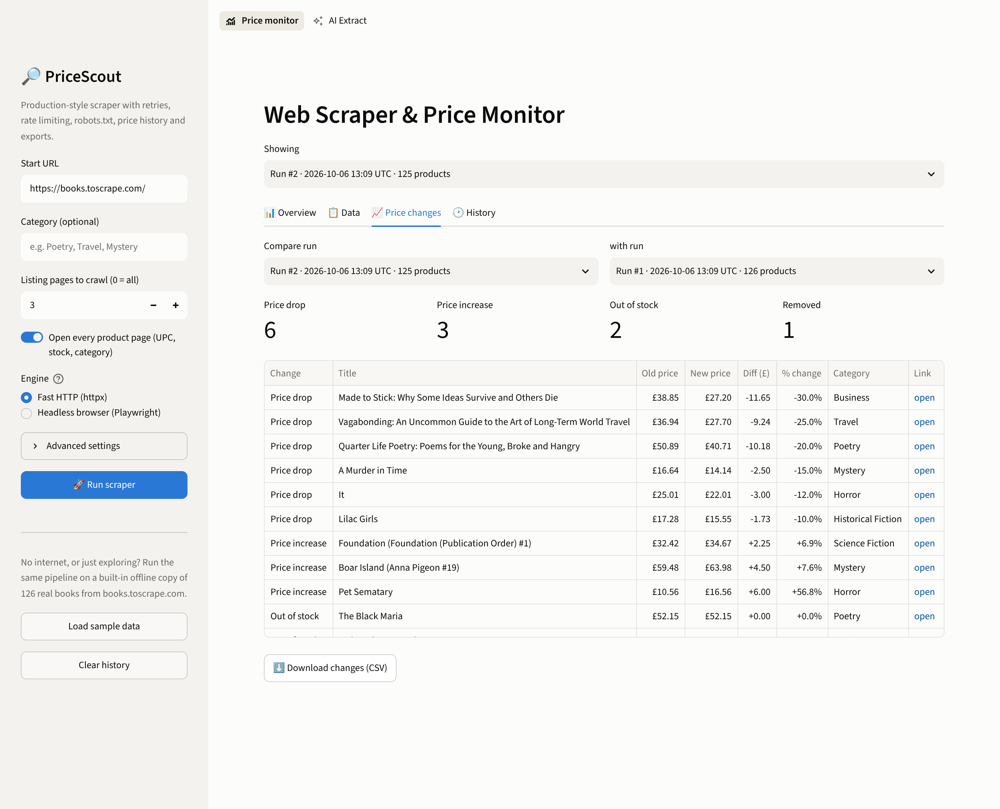
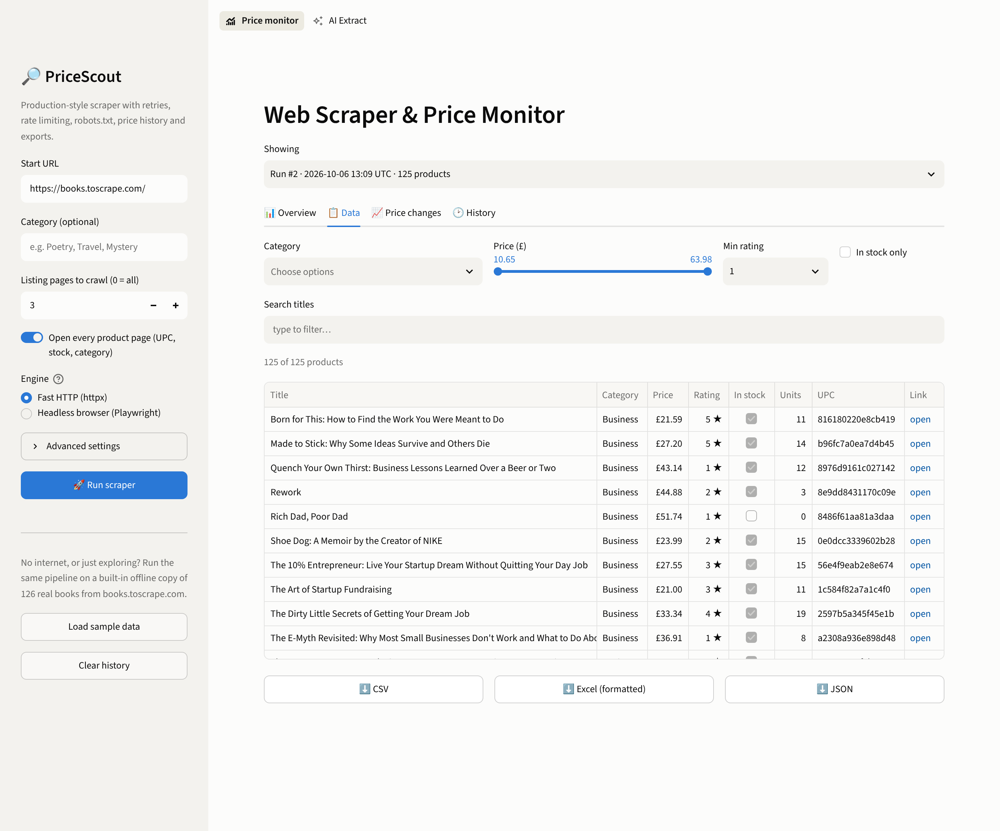
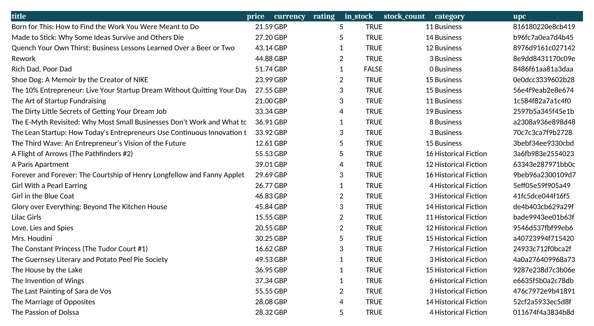
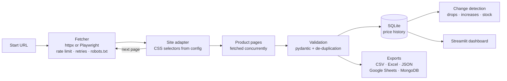

# PriceScout — Web Scraper & Price Monitor with AI Extraction


A production-style scraping pipeline that crawls an online catalogue, opens every product page,
validates the data, keeps a **price history**, detects **price drops and stock changes**, and delivers
the results as **CSV, formatted Excel, JSON, SQLite, Google Sheets or MongoDB** — with a dashboard on top.

The demo target is [books.toscrape.com](https://books.toscrape.com/), a sandbox site built for
scraping practice (1,000 products, 50 pages, 50 categories). Pointing PriceScout at another store
takes a small JSON file of CSS selectors — no code changes.

For one-off pages from stores you haven't configured, **AI Extract** reads the products from any product or
category page with no selectors at all: it uses the page's schema.org data when there is some (exact and free),
otherwise an **LLM** (Google Gemini on its free tier, OpenAI, Groq or a local Ollama model) extracts them through
function calling, and **every title, price and link is checked against the page** before it reaches you.



## What it does

| | |
|---|---|
| ✨ **AI Extract** | Any store page → products (title, price, sale price, stock, rating, SKU, link) without selectors. Structured data first, then the AI |
| 🛡️ **Checked AI output** | The AI must copy each price exactly as written; PriceScout then confirms the title, price text, old price and link are really on the page and flags anything that isn't |
| 🕷️ **Crawls** | Follows pagination, opens every product page concurrently, filters by category |
| ⚡ **Two engines** | Fast async HTTP (`httpx`) or a real headless browser (**Playwright**) for JavaScript-rendered sites |
| 🛡️ **Polite & resilient** | Global rate limit, retries with exponential backoff + jitter, honours `Retry-After`, respects `robots.txt` |
| ✅ **Clean data** | Every record validated with **pydantic**; duplicates removed; broken pages logged, not fatal |
| 📈 **Price monitoring** | Each run is stored in SQLite; changes between runs: price drop / increase, out of stock, back in stock, new, removed |
| 📤 **Exports** | CSV (Excel-friendly UTF-8), print-ready Excel with *Products / Summary / Changes* sheets, JSON, Google Sheets, MongoDB |
| 📊 **Dashboard** | Streamlit app to run scrapes, filter results, see charts, compare runs and download files |
| 🧩 **Config-driven** | New site = JSON with CSS selectors (`examples/site_config.json` shows a WooCommerce store) |
| 🧪 **Tested** | 65 automated tests, run offline against a local replica of the site built from real captured HTML, plus the AI flow with a scripted model and a fake OpenAI-compatible server |

## AI Extract: any store, no selectors





* **Cheap by design:** the page is cut down to its visible text (a category page is usually 1,000–5,000
  tokens), so it fits comfortably in the free Gemini tier. Pages that publish schema.org product data never
  reach the AI at all.
* **No invented data:** the model is told to copy prices exactly as written, and PriceScout verifies each one.
  A product the model made up, a price it misread or a link that isn't on the page is flagged ⚠️ with the
  reason, never silently exported.
* **Handles real store pages:** sale prices with crossed-out "was" prices, "Sold out" and "Pre-order" badges,
  `AED 1,299.00` / `Dhs 89.50` / `1.299,00 €` formats, and banners such as "Free shipping over AED 500"
  that are not products.
* **Safe for a public demo:** addresses on private networks (localhost, 10.x, cloud metadata) are refused,
  and every request is checked again, so a redirect can't lead there either.
* **Try it without a key:** three sample pages ship with the app. The fictional *Dune Electronics* page has
  schema.org data and works offline; the *Oasis Outdoor* category page (8 tents, sale prices, sold-out items)
  and a real books.toscrape.com page need an AI engine. Pick *Google Gemini (free tier)* in the sidebar and
  paste a free key from [aistudio.google.com](https://aistudio.google.com/apikey).

```bash
python -m pricescout extract --sample 1                                   # structured data, no key
python -m pricescout extract https://books.toscrape.com/catalogue/category/books/travel_2/index.html \
       --provider gemini --out output/travel.csv                          # reads GEMINI_API_KEY
```

## Screenshots

| Price changes between runs | Filter, search & download |
|---|---|
|  |  |

Formatted Excel export (excerpt):



> The screenshots were taken with the built-in offline copy of books.toscrape.com. **Load sample data**
> scrapes it twice and simulates a few price and stock changes in between, so the change tracker has
> something to show (the real sandbox never changes its prices). `scripts/demo_price_changes.py` does the
> same from the command line.

## Quick start

**Windows:** double-click `run_windows.bat` (creates a virtual environment, installs everything, opens the dashboard).

**macOS / Linux:** `./run_mac_linux.sh`

**Manual:**

```bash
python -m venv .venv
.venv\Scripts\activate          # Windows   (macOS/Linux: source .venv/bin/activate)
pip install -r requirements.txt
streamlit run app.py
```

Optional, only for the headless-browser engine: `playwright install chromium`

Optional, for AI Extract: paste a key in the sidebar, or copy `.streamlit/secrets.toml.example` to
`.streamlit/secrets.toml` and fill in `GEMINI_API_KEY` (on Streamlit Community Cloud, paste the same line into
*App settings → Secrets*). The secrets file is git-ignored; never commit a key.

## Command line

```bash
python -m pricescout scrape                          # whole catalogue -> output/*.csv, *.xlsx, *.json
python -m pricescout scrape --max-pages 3            # first 3 listing pages
python -m pricescout scrape --category Poetry        # one category (case-insensitive, suggests close matches)
python -m pricescout scrape --no-details             # listing pages only (fast)
python -m pricescout scrape --engine playwright      # headless Chromium for JavaScript sites
python -m pricescout scrape --gsheet <SHEET_KEY> --gsheet-credentials service_account.json
python -m pricescout scrape --mongo-uri mongodb://localhost:27017
python -m pricescout categories                      # list categories
python -m pricescout runs                            # scraping history
python -m pricescout changes --out output/changes.csv
python -m pricescout extract <URL> --provider gemini   # AI Extract on any store page
```

Example run (offline copy of the site, started with `python -m pricescout.mirror`):

```text
$ python -m pricescout scrape --url http://localhost:8765/ --category Poetry
PriceScout 1.0.0 | http://localhost:8765/ | engine=http
  category: Poetry
  page   1 -> 19 products found
  product pages: 10/19
  product pages: 19/19

Done
  products      : 19
  listing pages : 1
  requests      : 21 (retries: 0)
  duration      : 5.03s
  errors        : 0
  history run id: 1
  csv   -> output/products_20261006_171406.csv
  xlsx  -> output/products_20261006_171406.xlsx
  json  -> output/products_20261006_171406.json
```

## How it works



```
pricescout/
├── fetchers.py   # HttpFetcher (async, retries, backoff, Retry-After, rate limit, robots.txt) + PlaywrightFetcher
├── sites.py      # config-driven site adapter (CSS selectors -> fields)
├── pipeline.py   # pagination, concurrent detail pages, validation, de-duplication, progress events
├── models.py     # pydantic Product model
├── storage.py    # SQLite runs/snapshots + change detection
├── exporters.py  # CSV, JSON, formatted Excel, Google Sheets, MongoDB
├── mirror.py     # offline replica of books.toscrape.com (tests and demos)
├── ai_extract.py # AI Extract: page text, schema.org data, LLM tool call, checks against the page
├── llm.py        # one client for Gemini, OpenAI, Groq and Ollama (function calling, retries)
├── web_extract.py# the AI Extract page of the dashboard
└── cli.py        # `python -m pricescout ...`
app.py            # Streamlit dashboard: Price monitor + AI Extract
sample_pages/     # demo store pages for AI Extract (two fictional stores + one real sandbox page)
tests/            # 65 tests, real HTML fixtures captured from the site
```

## Scraping a different website

Write the selectors once and pass the file — nothing else changes:

```json
{
  "name": "my-store",
  "domains": ["shop.example.com"],
  "listing": {
    "item": "li.product",
    "fields": {
      "title": {"css": "h2.woocommerce-loop-product__title"},
      "url":   {"css": "a.woocommerce-LoopProduct-link", "attr": "href", "type": "url"},
      "price": {"css": "span.price ins .amount, span.price > .amount", "type": "price"}
    },
    "next_page": "a.next.page-numbers"
  }
}
```

```bash
python -m pricescout scrape --url https://shop.example.com/shop/ --site-config my_store.json
```

## Scheduling (daily price alerts)

* **Windows Task Scheduler:** action `python -m pricescout scrape`, start in the project folder.
* **Linux/macOS cron:** `0 7 * * * cd /path/to/pricescout && .venv/bin/python -m pricescout scrape`
* **GitHub Actions:** a `schedule:` workflow that runs the same command and uploads `output/` as an artifact.

Every run is added to `data/pricescout.db`, so the *Price changes* tab and `python -m pricescout changes`
always compare the latest run with the previous one.

## Tests

```bash
pip install -r requirements-dev.txt
pytest
```

The suite runs fully offline: parsers are tested on real HTML captured from books.toscrape.com, and the
end-to-end tests crawl `pricescout/mirror.py` — a local server that reproduces the site's structure,
relative links and missing charset header from 126 real products. It can also simulate failing pages
(503/500) and price changes, which is how retries, error handling and change detection are verified.
The Playwright engine is tested with a real headless Chromium. AI Extract is tested without any API key:
a scripted model and a small OpenAI-compatible server stand in for the LLM, so the tool call, the checks
against the page and the error handling run on every commit.

## Responsible scraping

PriceScout identifies itself with a user agent, respects `robots.txt`, limits its request rate and backs
off when a server is busy. Always check a website's terms of service before scraping it.

---

Built by **Fatma El Zahraa** — Data Scientist & ML Engineer.
Need data from a website, a price tracker, AI data extraction or a scheduled data pipeline?
[Contact me on Upwork](https://www.upwork.com/freelancers/~01f79195ceec502c59).
